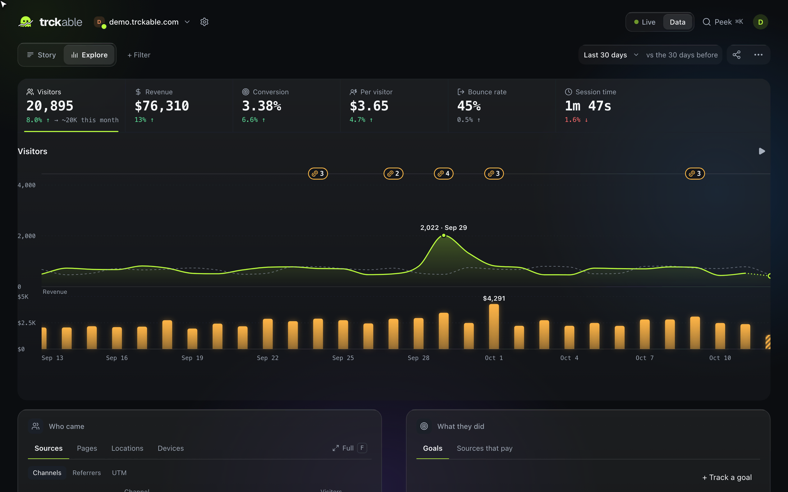
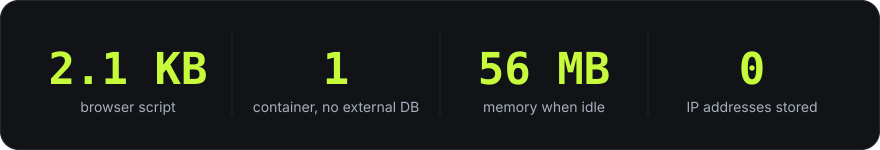
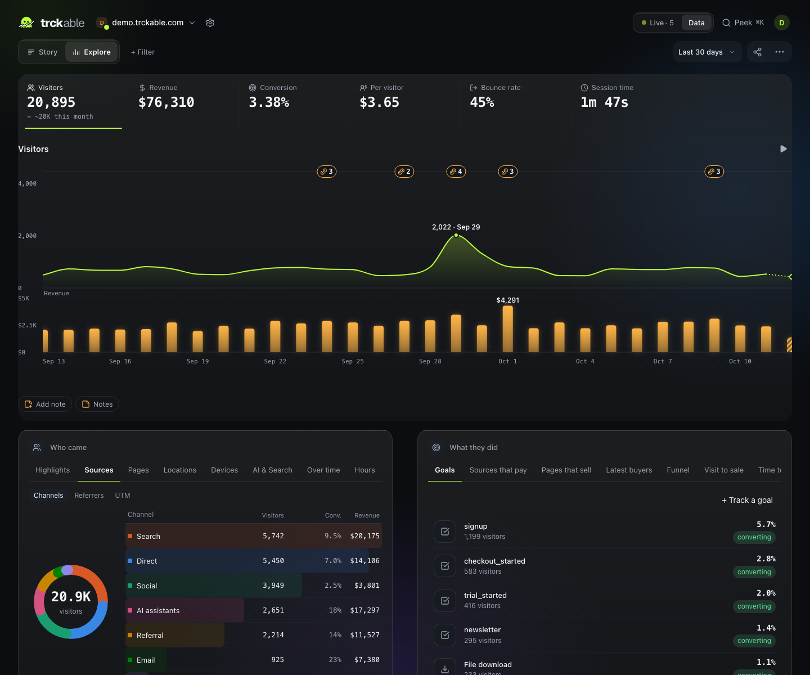
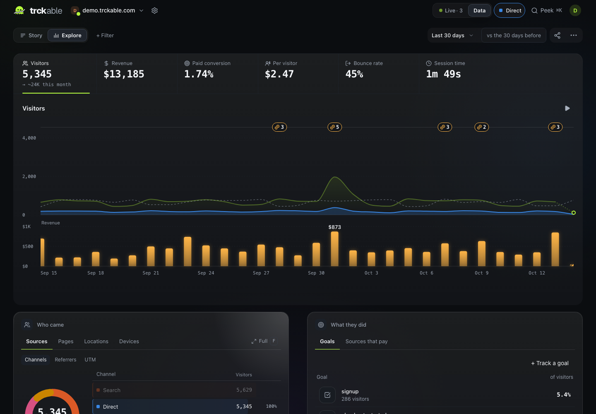
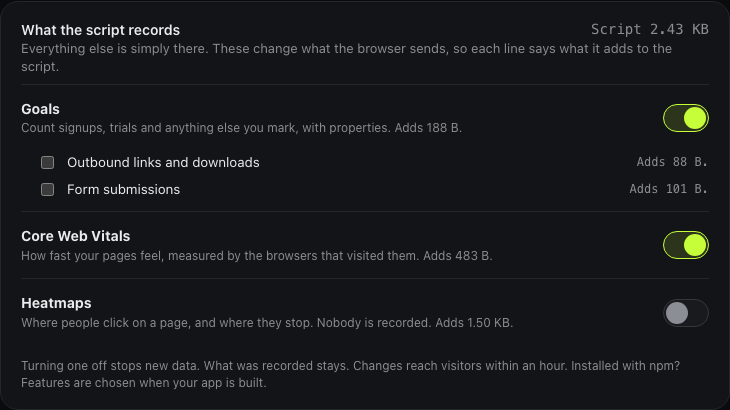
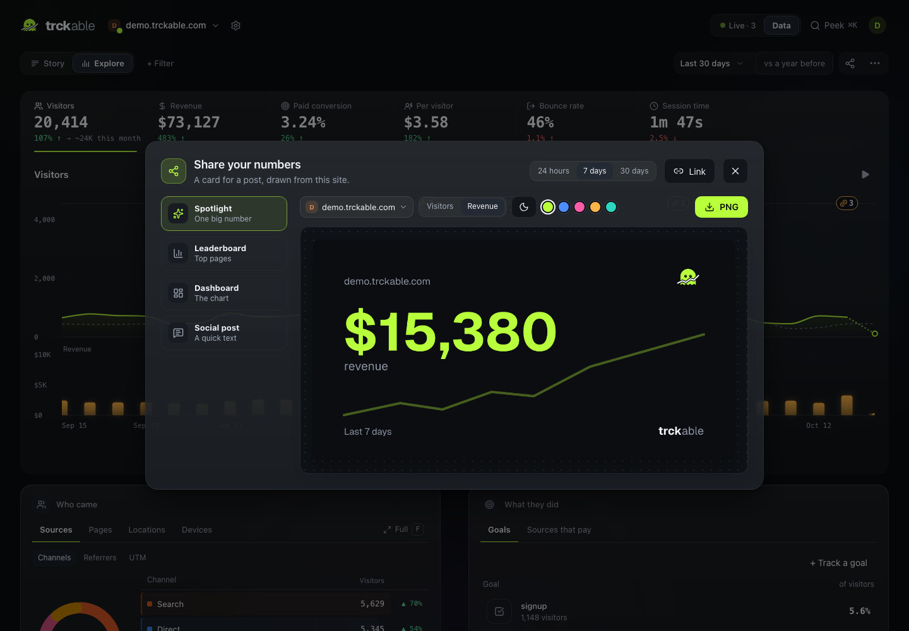
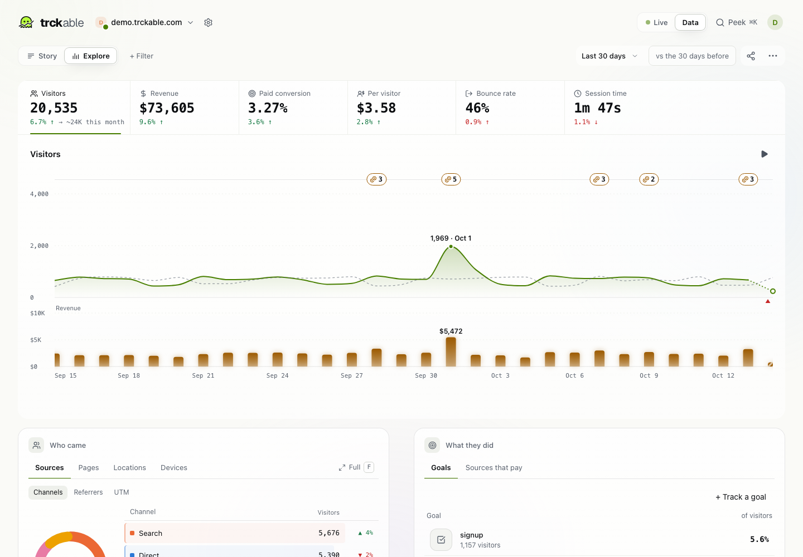

<div align="center">


# trckable

**The only analytics you need. Private, free and open source.**

Privacy-first, cookieless web analytics: a Google Analytics alternative you can self-host.<br>
**Free and open source (AGPL-3.0)**, self-hosted web analytics that also shows you **which traffic pays**.<br>
One container, a 2 KB script, and revenue attribution for Stripe, Lemon Squeezy, Polar, Paddle and Dodo.<br>
Self-host it for free, or let [trckable Cloud](https://cloud.trckable.com) run it for you.

[](CHANGELOG.md)
[](LICENSE)
[](packages/trckable/LICENSE)
[](server/go.mod) <!--f:badge_tracker--><a href="https://docs.trckable.com/benchmarks/"></a><!--/f--> <!--f:badge_memory--><a href="https://docs.trckable.com/benchmarks/"></a><!--/f-->

[Website](https://trckable.com) · [Cloud](https://cloud.trckable.com) · [Quick start](#quick-start) · [How it compares](#how-it-compares) · [What it does](#what-it-does) · [Gallery](#gallery) · [Docs](https://docs.trckable.com/) · [Changelog](CHANGELOG.md)

<a href="#quick-start"></a>

<br>



<sub>The demo site, recorded from the real dashboard: the comparison, the day under the pointer, Share, the money trail from Search, Full (<kbd>F</kbd>) and Replay.</sub>

<br><br>



</div>

> **Early preview.** Tracking, the dashboard, revenue for all five providers, Full mode, the MCP server and the self-hosting tools are built and tested. Still to come: live sandbox runs against each payment provider, the in-app assistant, and v1.0.

## Two ways to use it

**Self-host:** one container, on your own server. Free and open source (AGPL-3.0), every feature. **[trckable Cloud](https://cloud.trckable.com):** we run it, with updates and backups, after a 14-day free trial. Same product either way, and the same 2 KB script.

## Quick start

```bash
docker run -d --name trckable -p 8080:8080 -v trckable-data:/data ghcr.io/trckable/trckable
docker logs trckable   # a one-time setup link: open it, create your account, add your site
```

Then add the script tag from Settings → Install to your site's `<head>`; most sites are set up in under 3 minutes:

```html
<script
  defer
  data-site="tkb_a1b2c3d4"
  data-domain="example.com"
  src="https://stats.example.com/js/tkb_a1b2c3d4.js">
</script>
```

Or `npm i trckable` for React and Next.js, or the [WordPress plugin](integrations/wordpress). The image runs as an unprivileged user and works on x86-64 and arm64; details and upgrades are in the [install guide](https://docs.trckable.com/install/).

## Deploy

Compose, Railway, Coolify, Dokploy, Umbrel and Helm, all the same image with a data volume and a health check: [deploy/README.md](deploy/README.md) and the [self-hosting docs](https://docs.trckable.com/self-host/).

## How it compares

The free, self-hostable tools, plus DataFast (paid, hosted only) for script size, all measured the same way. Tables, sources and caveats: [How it compares](https://docs.trckable.com/compare/).

<p align="center">
  
</p>
<p align="center">
  
</p>

Where it is not the right pick: with pageviews only, Plausible CE's script is smaller (1,283 B against <!--f:tracker_core_bytes-->1,650<!--/f--> B). Session replay and A/B tests are out of scope on purpose; if you need those, use Matomo.

## What it does

Nothing is paid, limited or held back. The complete list: [features](https://docs.trckable.com/features/).

- **Which traffic pays.** Every sale is credited to the visit that earned it, for Stripe, Lemon Squeezy, Polar, Paddle and Dodo: [revenue](https://docs.trckable.com/revenue/).
- **Install anywhere.** A script tag, an npm package, WordPress and more: [platforms](https://docs.trckable.com/install/platforms/).
- **API and MCP server.** Read-only tools for Claude, Cursor or ChatGPT, and an HTTP API: [API](https://docs.trckable.com/api/), [MCP](https://docs.trckable.com/api/mcp/).
- **Sign in with Google, Microsoft or OIDC.** Free on every install: [sign-in](https://docs.trckable.com/self-host/sign-in-with-a-provider/).
- **Privacy by default.** Cookieless, no IP address ever stored: [privacy](https://docs.trckable.com/privacy/), and a printable [privacy report](docs/privacy-report.md) for every site.
- **Mentions.** See where your site is talked about (Hacker News, the news and blogs, Product Hunt) and the visitors each mention brought: [mentions](docs/mentions.md). A self-hosted server sends your site's address and the words you add to Algolia, Google News and GDELT to search, nothing about your visitors; it is off until `TRCKABLE_MENTIONS=on`.
- **Answers.** Whether ChatGPT, Perplexity and Claude name you for your buyers' questions, and the visitors and revenue the pages they link to bring: [answers](docs/answers.md). A self-hosted server sends your questions and an approximate country to OpenAI, Perplexity and Anthropic, nothing about your visitors; it is off until an AI key is set.
- **Heatmaps without recording anyone.** An opt-in module of about 1.5 KB: [heatmaps](docs/heatmaps.md).
- **Widgets for your own pages.** Live now, revenue, a privacy seal and Online, with no script and no cookie: [widgets](docs/widgets.md).
- **Client reports.** Weekly or monthly email and PDF for the people who pay for them: [client reports](docs/client-reports.md).
- **Your own look on share links.** Your logo and colour on shared pages: [share links](docs/share-links.md).
- **Keeps counting when your server is down.** Browsers hold what they could not send: [offline queue](docs/offline-queue.md).
- **Keyboard first.** Every key can be changed: [shortcuts](docs/keyboard-shortcuts.md), plus the [little things](docs/little-things.md).

## Gallery

<p align="center">
  
</p>
<p align="center">
  
  
</p>
<p align="center">
  
  
</p>
<p align="center">
  <sub>Explore across the whole width, the sources that pay, what the script records, the sharing links and the light theme. <a href="docs/screenshots.md">More screenshots</a></sub>
</p>

## How it's built

<p align="center">
  
</p>

Go, embedded DuckDB and SQLite, React with an in-house SVG chart kit. Every event is fsynced before it's acknowledged, every webhook is stored raw before it's processed, and both replay exactly once. How each number was measured: [By the numbers](https://docs.trckable.com/benchmarks/).

## Roadmap

- [ ] Mobile analytics: track your iOS and Android apps (coming soon)
- [ ] Live sandbox runs against each payment provider
- [ ] Peek: an optional in-app assistant on the same read-only tools, with your own AI key
- [ ] A mobile app (iOS and Android) to see your dashboard on your phone
- [ ] Public v1.0: a one-click deploy template, a public demo

What is already done: [CHANGELOG.md](CHANGELOG.md).

## Contributing

Contributions are welcome: how to build, test and send a change is in [CONTRIBUTING.md](CONTRIBUTING.md). Found a security problem? Please report it privately, as [SECURITY.md](SECURITY.md) explains.

## License


Server and dashboard [AGPL-3.0](LICENSE) · tracker and the `trckable` npm package [MIT](packages/trckable/LICENSE) · WordPress plugin [GPL-2.0-or-later](integrations/wordpress/trckable/license.txt) · geolocation by [DB-IP](https://db-ip.com) (CC BY 4.0)

The name trckable and the logo are not part of those licenses: a fork is welcome, under its own name. See [TRADEMARKS.md](TRADEMARKS.md).
