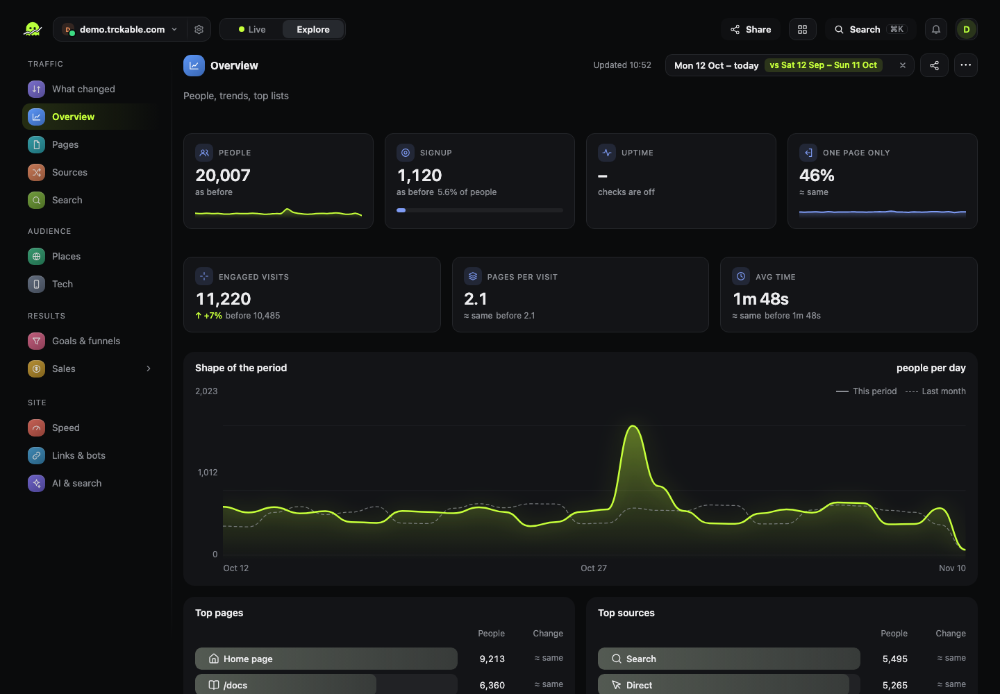
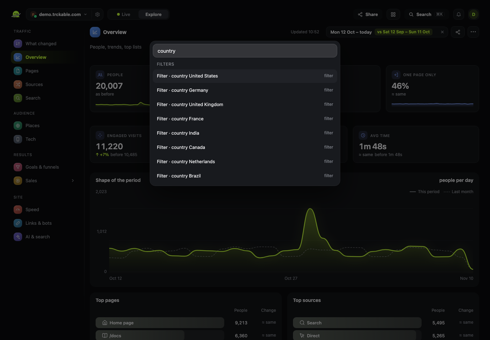
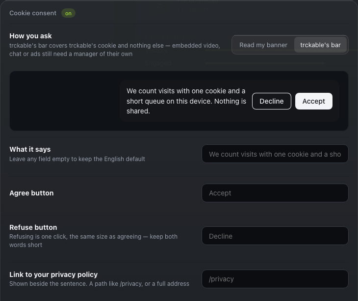
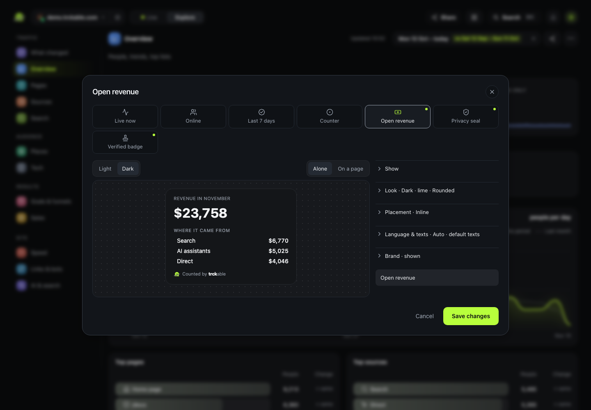

**Filters.** Open Search, type a dimension (country, source, device) and pick a value; every number on the screen narrows to it.

**Cookie consent.** Read your banner, or brand trckable's own bar.

**Widgets.** Live numbers for your own pages, with no script and no cookie.

Both themes are built to WCAG 2.1 AA and checked with axe-core.
